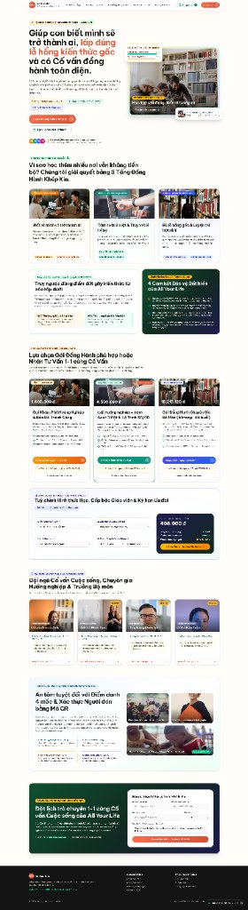

# Nền Tảng OYLG (All Your Life) — Hệ Sinh Thái Hướng Nghiệp, Cố Vấn Cuộc Sống & Đồng Hành Học Sinh (Lớp 1–12 & Sinh Viên)

> **Bản giao mã nguồn & Hướng dẫn cài đặt dành cho Đội ngũ Phát triển & AI Coding Agents (Claude Code, Cursor, Antigravity, Windsurf, Copilot).**
> Tài liệu đặc tả nghiệp vụ gốc (21 phân hệ `M01`–`M21`): xem chi tiết tại [`DAC_TA_NEN_TANG_OYLG.md`](./DAC_TA_NEN_TANG_OYLG.md).

<p align="center">
  
</p>

---

## 1. Tổng Quan Mô Hình Nghiệp Vụ & Kiến Trúc Hệ Thống

**All Your Life (OYLG)** là nền tảng giáo dục cá nhân hóa đồng hành cùng học sinh và gia đình qua **3 Tầng Chuyên Sâu**:
1. **Tầng 1 — Hướng Nghiệp Khám Phá Bản Thân (`B1–B4`, `RIASEC + Ikigai`)**: Giúp học sinh biết mình là ai, điểm mạnh cốt lõi và lộ trình nghề nghiệp phù hợp.
2. **Tầng 2 — Cố Vấn Cuộc Sống Toàn Diện 3 Mặt (`Kiến thức · Tinh thần · Thể chất`)**: Tầm soát định kỳ, cảnh báo sớm an toàn tâm lý (`M14` — Hotline 111/115) và đồng hành kỹ năng sống.
3. **Tầng 3 — Gia Sư Học Thuật Lấp Lỗ Hổng Gốc (`Lộ trình 60/40`)**: Truy vết ngược lỗ hổng kiến thức về lớp dưới (Adaptive Knowledge Tracing) và phân bổ **60% thời lượng bù hổng gốc + 40% bám sát bài trên lớp**.
4. **Dịch Vụ Mở Rộng — Nội Trú, Bán Trú & Đưa Đón An Toàn (`M21`)**: Quản lý dinh dưỡng, giấc ngủ, chống dị ứng và xác thực người đón hợp lệ bằng mã QR (`authorized_pickups`).

### Kiến Trúc Kết Hợp (EzyPlatform Java + Next.js Workspace)

Kho mã nguồn được thiết kế theo mô hình **Dual-Stack** giúp dễ dàng vừa tích hợp vào hệ sinh thái **EzyPlatform** (`ezycommerce`, `ezypayment`, `ezyarticle`), vừa có **Next.js Interactive Workspace** đầy đủ luồng nghiệp vụ cho tất cả 6 nhóm vai trò:

```text
pca-giasu/
├── oylg-sdk/                       # [EzyPlatform SDK] Entities, Repositories, Pricing/Commission/Guardrail Services & SQL
├── oylg-admin-plugin/              # [EzyPlatform Admin Plugin] Cổng quản trị EzyAdmin (:9090) & Page Fragments
├── oylg-web-plugin/                # [EzyPlatform Web Plugin] REST API E-Commerce, Checkout VietQR & Booking
├── oylg-theme/                     # [EzyPlatform Web Theme] Giao diện Thymeleaf SSR (:18080) đồng bộ CSS với Next.js
├── apps/
│   └── web/                        # [Next.js 15 App] Giao diện đầy đủ 6 Role Portals (:3456), Giỏ hàng, VietQR, AI Copilot
│       ├── src/app/page.tsx        # Trang chủ Storefront + Modal Đăng ký 3 bước + Đặt lịch Tư vấn 1-1
│       ├── src/app/pages/[slug]/   # Các trang con động (/pages/mo-hinh-3-tang, /pages/bang-gia, /pages/chuyen-gia...)
│       ├── src/app/parent/         # Cổng Phụ huynh (Ví buổi học, Đổi hình thức học, Dời lịch, Hoàn tiền 14 ngày)
│       ├── src/app/student/        # Không gian Học sinh (Chế độ Tiểu học/THCS-THPT, Trắc nghiệm thích ứng, Nhiệm vụ 60/40)
│       ├── src/app/coach/          # Không gian Cố vấn & Chuyên gia (Bản đồ nhiệt 4D, AI Copilot, Biên bản 60s)
│       ├── src/app/operations/     # Cổng Tuyển sinh & Hoa hồng 2 cấp (/sales) + Kiosk Nội trú & Đưa đón QR (/boarding)
│       ├── src/app/admin/          # Cổng Ban điều hành (4 chỉ số buổi sáng, Ma trận giá B6, Ghép lớp nhóm)
│       ├── src/app/ezyadmin/       # Trình quản trị EzyAdmin CMS & 10 Page Fragments động
│       └── src/lib/platform-store.tsx # Store trạng thái toàn cục (LocalStorage persistence cho Orders, Bookings, Logs)
├── packages/
│   ├── shared/                     # 4 Core Engines (Pricing B6, Commission 2 cấp, Curriculum 60/40, Guardrail M14) + Unit Tests
│   └── database/                   # Prisma Schema chuẩn hóa 21 phân hệ (M01–M21)
├── pom.xml                         # Maven Parent POM cho 4 module EzyPlatform
├── export.sh                       # Script đóng gói và xuất plugin/theme vào EzyPlatform
├── CLAUDE.md                       # Hướng dẫn chuyên biệt cho AI Coding Agents khi đọc và phát triển tiếp dự án
└── DAC_TA_NEN_TANG_OYLG.md         # Tài liệu đặc tả nghiệp vụ chi tiết (v1.0)
```

---

## 2. Hướng Dẫn Cài Đặt & Chạy Nhanh (Quick Start)

### Cách 1: Chạy Full Giao Diện Tương Tác 6 Vai Trò với Node.js (Nhanh nhất — 1 phút)

Phù hợp để **demo ngay toàn bộ luồng nghiệp vụ, kiểm thử UI/UX từng vai trò, hoặc để AI Agent phát triển tính năng mới**.

#### Yêu cầu hệ thống:
- **Node.js**: `>= 20.x`
- **pnpm**: `>= 9.x` (nếu chưa có, chạy `npm install -g pnpm`)

#### Các bước thực hiện:

```bash
# 1. Clone dự án về máy
git clone https://github.com/nguyenduchoai/pca-giasu.git
cd pca-giasu

# 2. Cài đặt dependencies cho toàn bộ monorepo
pnpm install

# 3. (Tuỳ chọn) Chạy 18 Unit Tests kiểm tra 4 Core Business Engines
pnpm test

# 4. Chạy ở chế độ Development (Mặc định mở tại http://localhost:3000)
pnpm dev

# HOẶC Build Production và chạy trên cổng 3456:
pnpm --filter @oylg/web build
pnpm --filter @oylg/web start
```

---

### Cách 2: Chạy Trên Nền Tảng EzyPlatform (Java 8 + Maven + MariaDB)

Phù hợp khi triển khai đồng bộ với **EzyPlatform Web (`:18080`)** và **EzyPlatform Admin (`:9090`)**.

#### Yêu cầu hệ thống:
- **JDK**: Java 1.8 (để chạy runtime EzyPlatform) & JDK 8+ cho Maven build
- **Maven**: `>= 3.8+`
- **MariaDB / MySQL**: Tạo database `oylg_ezy` (charset `utf8mb4`)
- **EzyPlatform Runtime**: Đặt tại `.ezy-runtime/ezyplatform/ezyplatform` (hoặc cấu hình đường dẫn trong file `local.properties`)

#### Các bước thực hiện:

```bash
# 1. Tạo file local.properties trỏ tới thư mục cài đặt EzyPlatform của bạn
cat << 'EOF' > local.properties
build.tool=maven
ezyplatform.home=/duong/dan/toi/ezyplatform
EOF

# 2. Build 4 module Java (oylg-sdk, oylg-admin-plugin, oylg-web-plugin, oylg-theme)
mvn clean install -DskipTests

# 3. Đồng bộ file CSS từ Next.js sang oylg-theme (khi có thay đổi giao diện)
pnpm --filter @oylg/web build
cat apps/web/.next/static/css/*.css > oylg-theme/src/main/resources/static/css/style.css

# 4. Xuất plugin & theme vào EzyPlatform
sh export.sh

# 5. Khởi chạy EzyPlatform Admin (:9090) và EzyPlatform Web (:18080)
cd /duong/dan/toi/ezyplatform
sh admin/console.sh "admin/plugins/oylg/lib/*:admin/plugins/oylg/resources:"
sh web/console.sh "web/themes/oylg/resources:web/plugins/oylg/lib/*:web/themes/oylg/lib/*:"
```

> **Lưu ý quan trọng về Tiếng Việt trên Java 8 (`messages*.properties`)**:
> Do Java 1.8 đọc file `.properties` theo chuẩn `ISO-8859-1`, tất cả các chuỗi tiếng Việt trong `oylg-theme/src/main/resources/messages/messages*.properties` và `oylg-admin-plugin/src/main/resources/messages/messages*.properties` phải được lưu dưới dạng **Unicode Escape (`\uXXXX`)** để không bị lỗi hiển thị ký tự trên tiêu đề trình duyệt (`<title>`).

---

## 3. Danh Sách Đường Dẫn (Routes) Kiểm Thử Theo Từng Vai Trò (Role-Based Testing)

Sau khi chạy dự án (ví dụ tại `http://localhost:3000` hoặc `http://localhost:3456`), bạn có thể truy cập hoặc dùng thanh **Chuyển đổi Vai trò (Role Switcher)** ở trên cùng để kiểm thử từng phân hệ:

| Vai trò (Role) | Đường dẫn (URL) | Các tính năng chính có thể bấm & trải nghiệm ngay |
| :--- | :--- | :--- |
| **1. Khách truy cập / Phụ huynh tìm hiểu** | `/` (các mục `#lo-trinh-3-tang`, `#bang-gia-goi-hoc`, `#doi-ngu-chuyen-gia`, `#noi-tru-an-toan`, `#dang-ky-tu-van`) <br> `/pages/co-van-tracie-anh` (hồ sơ từng chuyên gia) | • Xem mô hình 3 tầng, bảng giá gói học, hội đồng chuyên gia.<br>• Bấm **"Chọn Gói & Đăng Ký"** → Mở Modal 3 bước: Nhập hồ sơ con → Tạo mã **VietQR** → Bấm xác nhận thanh toán để tự động cộng buổi vào Ví.<br>• Bấm **"Giỏ gói học"** ở góc phải để thanh toán nhiều gói cùng lúc.<br>• Điền form **"Đặt lịch Tư vấn 1-1 Miễn phí"** ở cuối trang. |
| **2. Phụ huynh (`PARENT`)** | `/parent` | • Chuyển đổi giữa 3 hồ sơ con (Lớp 9, Lớp 11, Lớp 4 Tiểu học).<br>• Xem **Ví buổi học**, lịch học sắp tới và bấm **"Dời lịch nhanh"**.<br>• Đổi hình thức học từng buổi (**Zoom ↔ Trung tâm ↔ Tại nhà**) tự tính lại hệ số ví.<br>• Bấm **"Yêu cầu hoàn tiền 14 ngày"** cho đơn hàng `ezycommerce`.<br>• Chat với **Trợ lý AI CSKH 24/7** (dời lịch 1-chạm, tạo mã VietQR, chuyển người). |
| **3. Học sinh (`STUDENT`)** | `/student` | • Tự động đổi giao diện theo lứa tuổi (**Lớp 6–12 & Sinh viên** vs **Tiểu học Lớp 1–5** nhiều màu sắc).<br>• Làm bài **Trắc nghiệm Thích ứng (Adaptive Testing)**: nếu chọn đáp án sai ở Lớp 9, hệ thống tự động lùi câu hỏi về Lớp 8 → Lớp 7 để tìm đúng lỗ hổng gốc.<br>• Tích hoàn thành **Nhiệm vụ học tập 60/40 hôm nay** để nhận `+XP`.<br>• Check-in **Cảm xúc & Năng lượng học tập (`B3`)**. |
| **4. Cố vấn & Gia sư (`COACH / EXPERT`)** | `/coach` <br> `/coach/sessions` | • Kéo thanh trượt **Bản đồ nhiệt Kiến thức 4D** (`Tuần 1` → `Tuần 12`).<br>• Xem **AI Copilot Human-in-the-Loop** (ẩn danh hóa PII `[HS-2026-0089]`) & chuyển đổi 2 lớp hiển thị tâm lý (`B3` nội bộ vs Phụ huynh).<br>• Nhập **Biên bản buổi học 60 giây**: thử gõ số điện thoại (`0909123456` hoặc `không chín không...`) để kiểm tra bộ lọc chặn giao dịch ngoài luồng, hoặc gõ từ khóa nhạy cảm để kích hoạt cảnh báo an toàn tâm lý `M14`. |
| **5. Tư vấn viên & Quản sinh (`SALES / BOARDING`)** | `/operations/sales` <br> `/operations/boarding` | • **Cổng Tuyển sinh (`/operations/sales`)**: Tạo phiếu tư vấn mới và mô phỏng **Hoa hồng 2 cấp (`PAY_AS_COLLECTED`)** kèm điều khoản clawback khi hoàn học phí.<br>• **Kiosk Nội trú & Bán trú (`/operations/boarding`)**: Cập nhật nhật ký ăn/ngủ/dị ứng và bấm **"Xác thực QR Đón Học Sinh"** (tự động chặn người đón không nằm trong danh sách ủy quyền). |
| **6. Ban điều hành & Quản trị CMS (`ADMIN`)** | `/admin` <br> `/ezyadmin` <br> `/ezyadmin/page-fragments` <br> `/studio` | • **Ban điều hành (`/admin`)**: Xem 4 chỉ số buổi sáng, điều chỉnh **Đơn giá chuẩn B6** toàn hệ thống, và bấm **"Khai giảng Lớp nhóm"** khi đủ sĩ số.<br>• **CMS Page Fragments (`/ezyadmin/page-fragments`)**: Chỉnh sửa trực tiếp nội dung 10 khối giao diện trang chủ (live-edit đồng bộ ngay ra ngoài trang chủ).<br>• **Studio Học liệu (`/studio`)**: Duyệt câu hỏi AI sinh cho 4 bộ công cụ `B1–B4`. |

---

## 4. Hướng Dẫn Dành Cho Khách Hàng Dùng AI Để Phát Triển Tiếp

Dự án này đã được cấu hình sẵn file [`CLAUDE.md`](./CLAUDE.md) và [`DAC_TA_NEN_TANG_OYLG.md`](./DAC_TA_NEN_TANG_OYLG.md) ở thư mục gốc. Khi mở thư mục dự án bằng **Claude Code**, **Cursor**, **Antigravity**, hoặc **Windsurf**, bạn chỉ cần giao việc cho AI bằng các câu lệnh mẫu sau:

1. **Khi muốn hiểu toàn bộ kiến trúc & luồng hiện tại**:
   > *"Hãy đọc file `CLAUDE.md` và `DAC_TA_NEN_TANG_OYLG.md` để nắm toàn bộ kiến trúc dự án OYLG, sau đó tóm tắt các module hiện có."*
2. **Khi muốn kết nối Database thực tế (PostgreSQL/MariaDB) thay cho Store giả lập**:
   > *"Hãy dựa vào schema trong `packages/database/prisma/schema.prisma` và `apps/web/src/lib/platform-store.tsx` để chuyển các thao tác đặt gói học, đặt lịch và biên bản buổi học sang lưu trữ trực tiếp trong database qua API Routes."*
3. **Khi muốn tích hợp cổng thanh toán PayOS / SePay thực tế**:
   > *"Hãy cập nhật luồng thanh toán VietQR trong `apps/web/src/components/EcommerceCartDrawer.tsx` và `oylg-web-plugin` để gọi webhook xác nhận giao dịch tự động từ PayOS/SePay."*
4. **Khi chỉnh sửa giao diện và muốn đồng bộ sang EzyPlatform Theme**:
   > *"Sau khi sửa giao diện trong `apps/web`, hãy đồng bộ sang `oylg-theme/src/main/resources/templates/page.html` và cập nhật `style.css` theo hướng dẫn trong `CLAUDE.md`."*
