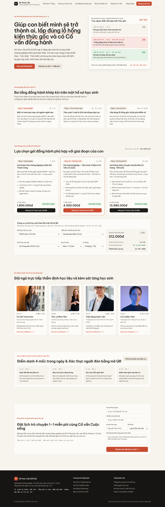

# Nền Tảng OYLG (All Your Life) — 100% Native EzyPlatform (v2.0)

> **Hệ sinh thái Hướng nghiệp, Cố vấn Cuộc sống & Gia sư Bù Lỗ Hổng Gốc cho Học sinh Lớp 1–12**, xây dựng **thuần 100% trên EzyPlatform (`oylg-sdk`, `oylg-admin-plugin`, `oylg-web-plugin`, `oylg-theme`)** theo kiến trúc mẫu Theme `Consulting` và tiêu chuẩn thiết kế giao diện **Unslop**.
> Tài liệu đặc tả nghiệp vụ gốc (21 phân hệ `M01`–`M21`): [`DAC_TA_NEN_TANG_OYLG.md`](./DAC_TA_NEN_TANG_OYLG.md).

<p align="center">
  
</p>

---

## 1. Kiến Trúc 4 Module Chuẩn EzyPlatform (100% SSOT)

```text
pca-giasu/
├── pom.xml                         # Maven Parent POM (ezyplatform-parent, Java 1.8 target)
├── build.properties                # Khai báo liên kết Plugin EzyPlatform Market
├── export.sh                       # Đóng gói & xuất tự động plugin + theme vào EzyPlatform
├── oylg-sdk/                       # [Domain & Data SSOT] 15 Entities, 15 Repositories, 4 Core Services & SQL
│   └── src/main/resources/scripts/scripts.sql
├── oylg-admin-plugin/              # [EzyAdmin Plugin :9090] 9 màn hình quản trị gốc (layout:decorate="~{ezyadmin}")
├── oylg-web-plugin/                # [Web REST APIs] /api/v1/oylg/* (B6 Quote, VietQR, Hoàn tiền 14N, DLP, M14, QR)
├── oylg-theme/                     # [Web Theme :18080] 10 trang Thymeleaf SSR + Unslop CSS/JS độc lập
│   └── src/main/resources/
│       ├── static/css/style.css    # Hệ thống Token Unslop (Warm Paper Ramp + Graphite App Ramp, 4px grid)
│       ├── static/js/main.js       # Kết nối AJAX tới /api/v1/oylg/* (Không phụ thuộc Node/Next.js)
│       └── templates/              # page.html, home.html, member-landing.html, parent/*, student/*, coach/*, operations/*, admin/*
├── .agents/skills/unslop/          # Skill kiểm định thiết kế giao diện chống AI-slop (@heydamir/unslop)
└── CLAUDE.md                       # Ngữ cảnh tự động cho AI Coding Agents (Claude Code, Cursor, Antigravity)
```

---

## 2. Bảng Giá Gốc Thống Nhất (SSOT trong `ezy_settings` & `oylg_service_packages`)

- **Đơn giá cơ sở B6 (`oylg_base_session_price`)**: **`200.000đ / buổi (90 phút)`**
- **Gói Tầng 1 (`PKG-T1-CAREER`)**: **`1.800.000đ`** *(2 buổi chuyên gia — Khám phá Hướng nghiệp RIASEC + Big Five & Bản đồ Thành công R1)*
- **Gói Tầng 1 & 2 (`PKG-T12-COACH`)**: **`4.500.000đ`** *(12 buổi — Hướng nghiệp + Tầm soát 3 mặt Kiến thức · Tinh thần · Thể chất & Cố vấn)*
- **Gói Tầng 3 (`PKG-T3-TUTOR-6M`)**: **`13.980.000đ`** *(48 buổi / 6 tháng, đã ưu đãi `-7%` đóng dài hạn — Gia sư Bộ môn phác đồ 60/40)*

---

## 3. Hướng Dẫn Cài Đặt & Chạy Trên Máy Local

### Yêu cầu hệ thống
- **Java 1.8** (chạy runtime EzyPlatform) + **OpenJDK** & **Maven 3.8+** (biên dịch)
- **MySQL / MariaDB** (tạo database `ezyplatform` chuẩn `utf8mb4_unicode_520_ci`)
- **EzyPlatform `1.5.6`** & **EzyPlatform SDK `0.2.4`**

### Bước 1: Cấu hình kết nối Database trong `$EZYPLATFORM_HOME/settings/setup.properties`
```properties
datasource.jdbc_url=jdbc:mariadb://127.0.0.1:33062/ezyplatform?allowPublicKeyRetrieval=true&useSSL=false
datasource.driver_class_name=org.mariadb.jdbc.Driver
datasource.username=ezy
datasource.password=12345678
tables.create_manually=false
```

### Bước 2: Biên dịch & Xuất 4 Module vào EzyPlatform
```bash
bash export.sh
```

### Bước 3: Khởi chạy EzyAdmin (`:9090`) & EzyPlatform Web (`:18080`)
```bash
export JAVA_HOME=$(/usr/libexec/java_home -v 1.8)
export PATH="$JAVA_HOME/bin:$PATH"
cd $EZYPLATFORM_HOME

# Cổng Quản trị EzyAdmin (:9090) — Đăng nhập Market để cài thêm các Plugin Free (ezyarticle, ecommerce, ezypayment, ezylogin, ezysupport)
sh admin/console.sh "admin/plugins/oylg/lib/*:admin/plugins/oylg/resources:"

# Cổng Website & 6 Không gian Vai trò (:18080)
sh web/console.sh "web/themes/oylg/resources:web/plugins/oylg/lib/*:web/themes/oylg/lib/*:"
```

---

## 4. Danh Sách Đường Dẫn Kiểm Thử Theo Từng Vai Trò (`http://localhost:18080` & `:9090`)

| Nhóm vai trò | Đường dẫn (URL) | Chức năng thực tế (Lưu trực tiếp vào MySQL) |
| :--- | :--- | :--- |
| **1. Trang chủ & Hồ sơ Chuyên gia** | `http://localhost:18080/` <br> `http://localhost:18080/pages/co-van-tracie-anh` | Sơ đồ truy ngược lỗ hổng gốc YCCĐ, bảng giá 3 tầng, công cụ tính học phí B6, đăng ký VietQR cộng buổi vào Ví, đặt lịch tư vấn 1–1. |
| **2. Phụ huynh (`PARENT`)** | `http://localhost:18080/parent` | Chọn hồ sơ con (Lớp 9 / Lớp 11 / Lớp 4), xem Ví buổi học, bấm đổi hình thức học từng buổi (`Zoom ↔ Trung tâm ↔ Tại nhà`), dời lịch nhanh, yêu cầu hoàn tiền 14 ngày. |
| **3. Học sinh (`STUDENT`)** | `http://localhost:18080/student` | Trắc nghiệm thích ứng tự động lùi từ Lớp 9 → Lớp 8 → Lớp 7 khi chọn sai, gợi mở Socratic, đánh dấu nhiệm vụ 60/40 cộng `+XP`, check-in năng lượng `B3`, đổi chế độ Tiểu học. |
| **4. Cố vấn & Gia sư (`COACH / TUTOR`)** | `http://localhost:18080/coach` <br> `http://localhost:18080/coach/sessions` | Tháp hồ sơ phụ trách, bản đồ nhiệt YCCĐ 4D (`Tuần 1 → 12`), phân tách 2 lớp tâm lý `B3`, Sổ đầu bài 60s tự động che SĐT/Zalo (kể cả viết bằng chữ) & kích hoạt cờ đỏ `M14` (`111 / 115`). |
| **5. Tuyển sinh & Nội trú (`SALES / BOARDING`)** | `http://localhost:18080/operations/sales` <br> `http://localhost:18080/operations/boarding` | Phễu khách hàng đăng ký, mô phỏng hoa hồng 2 cấp `PAY_AS_COLLECTED`, Kiosk quản sinh tách thực đơn dị ứng & quét QR xác thực người đón (chặn người lạ ngay lập tức). |
| **6. Ban Điều hành, Studio & EzyAdmin** | `http://localhost:18080/admin` <br> `http://localhost:18080/studio` <br> `http://localhost:9090/oylg/dashboard` | 4 chỉ số buổi sáng, chỉnh đơn giá gốc B6 lưu thẳng vào `ezy_settings`, khai giảng lớp nhóm cùng lỗ hổng gốc, thẩm định ngân hàng câu hỏi B1–B4, và cài đặt Plugin trên EzyAdmin `:9090`. |
